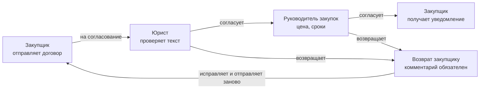

# ТЗ: согласование договора с поставщиком в 1С:ДО

> Результат первого промпта. Копия документа, созданного в Docs. Схема маршрута в оригинале была нарисованной картинкой, здесь она переписана в Mermaid.

## 1. Общие сведения

Документ описывает автоматизацию согласования договора с поставщиком в 1С:Документооборот (1С:ДО): от отправки карточки закупщиком до согласия руководителя отдела закупок.

- **Заказчик:** отдел закупок.
- **Основание:** интервью аналитика с представителем отдела закупок (анкета из 12 вопросов).
- **Граница процесса:** маршрут заканчивается согласованием руководителя. Подписание договора оформляется отдельно и в процесс не входит.

| Термин | Значение |
| --- | --- |
| Закупщик | Сотрудник отдела закупок, который ведёт договор: создаёт карточку, прикладывает проект и отправляет на согласование |
| Юрист | Первый согласующий: проверяет условия, ответственность сторон и формулировки |
| Руководитель закупок | Второй согласующий: проверяет цену, сроки поставки и условия оплаты |
| Карточка договора | Карточка документа в 1С:ДО, в которой идёт согласование |
| Проект договора | Файл с текстом договора, прикреплённый к карточке |

## 2. Цели и границы

Цель: провести проект договора через юридическую проверку и согласие руководителя закупок до подписания, а все замечания и решения хранить в одной карточке.

**В области автоматизации:**

- создание карточки договора и запуск согласования;
- последовательные этапы: юрист, затем руководитель закупок;
- возврат на доработку с обязательным комментарием и повторное согласование;
- уведомление закупщика о завершении согласования.

**Вне области:**

- подписание договора (оформляется отдельно);
- другие типы документов и договоры с клиентами: в анкете они не обсуждались.

## 3. Сценарий процесса

Процесс идёт от закупщика к юристу, от юриста к руководителю закупок; любой возврат ведёт обратно к закупщику, а повторное согласование всегда начинается с юриста.

1. Закупщик создаёт карточку договора, указывает поставщика и наименование, прикладывает файл проекта.
2. Закупщик отправляет договор на согласование; без файла отправка невозможна.
3. Юрист получает задачу первым и проверяет условия договора, ответственность сторон и формулировки. Согласует или возвращает закупщику с замечаниями.
4. После согласия юриста задача появляется у руководителя отдела закупок. Он проверяет цену, сроки поставки и условия оплаты. Согласует или возвращает закупщику (даже если юрист уже согласовал, например при расхождении по авансу и оплате после поставки).
5. При возврате закупщик открывает ту же карточку, читает замечания, исправляет проект, прикладывает новую версию файла и сам отправляет договор заново. Согласование начинается с пункта 3.
6. После согласия руководителя процесс завершается, закупщику приходит уведомление в 1С:ДО.

## 4. Функциональные требования к маршруту

Система должна реализовать последовательный маршрут «юрист → руководитель закупок» с возвратами к закупщику. В колонке «Вопрос» указан номер вопроса анкеты, из которого взято требование.

| № | Требование | Вопрос |
| --- | --- | --- |
| ФТ-1 | Закупщик создаёт карточку договора и отправляет её на согласование из 1С:ДО | 2 |
| ФТ-2 | Отправка блокируется, пока не заполнены поставщик и наименование договора и не прикреплён файл проекта; система показывает, что не заполнено | 3 |
| ФТ-3 | Первым этапом всегда идёт согласование юриста | 4 |
| ФТ-4 | Задача руководителя закупок создаётся только после согласования юристом | 5 |
| ФТ-5 | Каждый согласующий может выбрать «Согласовать» или «Вернуть на доработку» | 4, 5 |
| ФТ-6 | Руководитель закупок может вернуть договор, уже согласованный юристом; возврат идёт сотруднику, который отправил договор | 6 |
| ФТ-7 | При возврате комментарий обязателен для юриста и для руководителя; при пустом комментарии система просит его заполнить | 7 |
| ФТ-8 | После возврата закупщик работает в той же карточке: видит замечания, прикладывает новую версию файла и сам повторно отправляет договор | 8 |
| ФТ-9 | Повторное согласование всегда начинается с юриста, кто бы ни вернул договор; юрист видит обновлённый проект | 9 |
| ФТ-10 | После согласия руководителя процесс завершается и закупщику приходит уведомление в 1С:ДО | 10 |

## 5. Участники и роли

В процессе три роли, но способ назначения конкретных согласующих заказчик пока не выбрал: это открытый вопрос № 1 в разделе 10.

| Роль | Действия в процессе | Как находится исполнитель |
| --- | --- | --- |
| Закупщик | Создаёт карточку, прикладывает проект, отправляет и повторно отправляет договор, получает уведомление о согласовании | Сотрудник, ведущий договор; возврат идёт тому, кто отправил |
| Юрист | Согласовывает или возвращает договор с комментарием | Открыто: по роли, подразделению или конкретный сотрудник |
| Руководитель закупок | Согласовывает или возвращает договор с комментарием | Открыто: по роли, подразделению или конкретный сотрудник |

Права доступа к карточке в анкете не обсуждались; минимум, который требуется для маршрута, — каждая роль видит карточку, файл проекта и комментарии на своём этапе.

## 6. Карточка договора

Для запуска согласования нужны только три обязательных данных: поставщик, наименование и файл проекта. Другие реквизиты (сумма, срок действия, вид договора) в анкете не названы и в ТЗ не включены.

| Поле | Обязательность | Правило |
| --- | --- | --- |
| Поставщик | Да, при отправке | Без него отправка невозможна |
| Наименование договора | Да, при отправке | Без него отправка невозможна |
| Файл проекта | Да, при отправке | Пустая карточка без файла не отправляется; при возврате закупщик прикладывает новую версию |
| Комментарии согласующих | Да, при возврате | Текст замечания виден закупщику в той же карточке |

**Версии файла.** Хранить ли предыдущие версии проекта в карточке, не решено (открытый вопрос № 2). В любом варианте юрист обязан видеть актуальный файл после повторной отправки.

## 7. Уведомления, сроки и замещение

Обязательное уведомление сейчас одно: закупщик узнаёт о завершении согласования в 1С:ДО. Сроки этапов, напоминания и замещение отсутствующих заказчик обсудит отдельно, поэтому в этой версии ТЗ они не требуются.

| Событие | Кто уведомляется | Статус |
| --- | --- | --- |
| Договор согласован руководителем, процесс завершён | Закупщик | Требуется |
| Новая задача на этапе | Согласующий этапа (стандартная задача 1С:ДО) | Требуется |
| Сроки этапов, напоминания, эскалация | — | Открыто (вопросы № 3 и № 4) |
| Замещение юриста и руководителя при отсутствии | — | Открыто (вопрос № 5) |

## 8. Нефункциональные требования

Анкета не затрагивала производительность, отчётность и хранение, поэтому ниже — минимум, вытекающий из маршрута, и допущения, которые нужно подтвердить.

- История согласования (кто, когда, решение, комментарий) должна сохраняться в карточке и быть доступна участникам процесса. *Допущение.*
- Маршрут должен работать на стандартных средствах бизнес-процессов 1С:ДО без внешних интеграций: в анкете они не упоминались. *Допущение.*
- Отчёты по срокам и нагрузке согласующих: не обсуждались, в ТЗ не включены.

## 9. Приёмка

Приёмка проходит по четырём сценариям из маршрута; каждый проверяется на тестовой карточке договора с тремя ролями.

| Сценарий | Ожидаемый результат | Требования |
| --- | --- | --- |
| Пустая карточка или карточка без файла | Отправка невозможна, система показывает, что не заполнено | ФТ-1, ФТ-2 |
| Однократное согласование юристом и руководителем | Задача руководителя появляется после юриста, процесс завершён, закупщик получил уведомление | ФТ-3, ФТ-4, ФТ-10 |
| Возврат юристом без комментария и с комментарием | Без комментария система не принимает решение; с комментарием закупщик видит замечания | ФТ-5, ФТ-7, ФТ-8 |
| Возврат руководителем после согласования юриста | Договор уходит закупщику; после повторной отправки задача снова появляется у юриста, а не у руководителя | ФТ-6, ФТ-8, ФТ-9 |

Обучение в анкете не обсуждалось; для трёх ролей достаточно короткой инструкции по своему этапу. *Допущение.*

## 10. Открытые вопросы

Пять вопросов анкета оставила нерешёнными; без первого из них нельзя настроить маршрут, остальные можно закрыть после запуска.

| № | Вопрос | Откуда | Влияет на |
| --- | --- | --- | --- |
| 1 | Как назначать юриста и руководителя в задачи: по роли, подразделению или конкретный сотрудник | Вопрос 11 | Настройка маршрута, раздел 5 |
| 2 | Хранить ли предыдущие версии файла проекта в карточке | Вопрос 8 | Карточка, раздел 6 |
| 3 | Сроки на каждый этап согласования | Вопрос 12 | Контроль сроков, раздел 7 |
| 4 | Нужны ли напоминания согласующим | Вопрос 12 | Уведомления, раздел 7 |
| 5 | Кто согласует за отсутствующего юриста или руководителя | Вопрос 12 | Замещение, раздел 7 |
